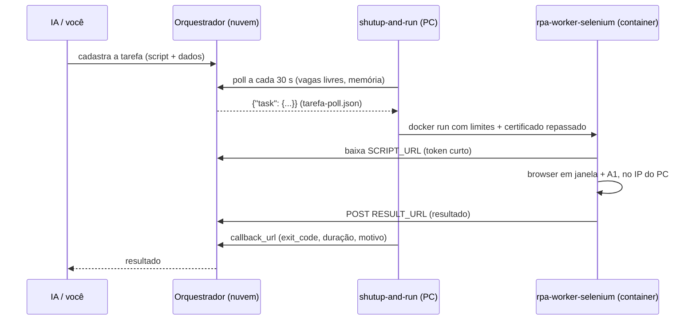

# Receita: o worker no PC com o shutup-and-run

O [shutup-and-run](https://github.com/nailtongomes/shutup-and-run) roda containers num PC (Windows 11 com
WSL2, ou Linux) sem porta aberta: ele busca tarefas no seu orquestrador (poll) ou roda containers
gerenciados sozinho. Esta imagem é o que roda dentro do container. A combinação serve para as
automações mais difíceis, por três motivos:

- **O certificado A1 fica no PC.** O dono importa o `.pfx` uma vez (repasse de certificado), e cada
  container recebe uma cópia só de leitura, apagada ao fim da tarefa. Nada passa pela nuvem.
- **A saída é a internet do próprio PC** (IP residencial). Aos olhos do tribunal ou do GOV.BR é uma pessoa
  no computador dela, não um datacenter.
- **Nenhuma porta aberta no PC.** O PC chama a nuvem, não o contrário.

| Arquivo | Para quê |
|---|---|
| [`teste-a1.json`](teste-a1.json) | container gerenciado `once`: roda o `preflight` (browsers + A1 + Java/PJeOffice) e sai |
| [`rotina.json`](rotina.json) | container gerenciado `interval`: roda `SCRIPT_URL` a cada 15 min |
| [`tarefa-poll.json`](tarefa-poll.json) | resposta da sua URL de poll com uma tarefa (orquestrador na nuvem, IA) |
| [`modelo_tarefa.py`](modelo_tarefa.py) | modelo de script: A1 + browser em janela + resultado por POST |

## Como o certificado chega ao container

Com o repasse de certificado ligado, **todo** container do PC recebe os dois arquivos abaixo, em caminhos
fixos. As receitas só apontam as variáveis da imagem para eles:

| Variável da imagem | Valor nas receitas | O que é |
|---|---|---|
| `A1_PFX_PATH` | `/run/shutup-and-run/certificate/client.pfx` | o `.pfx`, somente leitura |
| `A1_PFX_PASSWORD_FILE` | `/run/shutup-and-run/secrets/certificate-password` | a senha, como único conteúdo do arquivo |

A senha nunca está no env da tarefa, no orquestrador, em log nem no histórico do shutup-and-run.
O script carrega o certificado com `a1cert.load_from_env()`, como em qualquer outro lugar.

## Tamanho

| | Receita | Por quê |
|---|---|---|
| `memory` | `2g` | pico medido com PJeOffice: ~1,1 GB. 2 GB também é o limite padrão por tarefa do perfil `shared-pc` (pedir mais é recusado) |
| `shm` | `1g` | `/dev/shm` do Chrome |
| `cpu` | `1` | limite padrão do `shared-pc`. Funciona, mas com 1 CPU a primeira abertura do browser pode levar até 1 min enquanto o PJeOffice sobe. Com `max_job_cpus 2` no PC, use `"cpu": 2` |
| disco | ~5,4 GB | a imagem; o primeiro download demora, e o `shutup-and-run jobs` mostra o progresso |

Um PC com menos de 8 GB de memória ou 2 processadores fica em **alerta**: o dono precisa autorizar uma vez
(`shutup-and-run safety authorize`, ou a página local). Veja "Protegendo o PC" no README do shutup-and-run.

## 0. Preparar o PC (uma vez)

No Windows 11, PowerShell (instala o shutup-and-run e o WSL2):

```powershell
irm https://raw.githubusercontent.com/nailtongomes/shutup-and-run/main/scripts/install.ps1 | iex
```

```powershell
shutup-and-run wsl install
```

Libere esta imagem (e só ela: assim uma tarefa errada não roda outra imagem com o seu certificado):

```powershell
shutup-and-run config set allowlist ghcr.io/nailtongomes/rpa-worker-selenium --apply
```

Importe o certificado. A senha vem de uma variável de ambiente da sessão, nunca da linha de comando:

```powershell
$env:SHUTUP_AND_RUN_CERT_PASSWORD = Read-Host "Senha do certificado"
```

```powershell
shutup-and-run certificate set --file "C:\Users\voce\certificados\meu-a1.pfx" --accept-risk --apply
```

```powershell
Remove-Item Env:SHUTUP_AND_RUN_CERT_PASSWORD; shutup-and-run certificate validate
```

> Com o repasse ligado, **todo** container que este PC rodar consegue ler o certificado e a senha.
> No seu PC e só com esta imagem na allowlist, é o que se quer. No PC de um cliente, é o certificado
> dele, e a decisão é dele.

No Linux, os mesmos comandos com `sudo` (e `SHUTUP_AND_RUN_CERT_PASSWORD='...'` antes do `certificate set`).

## 1. Testar o certificado A1 no PC

Baixe [`teste-a1.json`](teste-a1.json) e rode uma vez. O container sobe Xvfb, OpenBox e PJeOffice e roda
`/app/preflight.py`. Ele confere se os browsers abrem e se o certificado funciona: abre o `.pfx`, assina um
`.p7s` e um PDF, o Java do PJeOffice lê o certificado, e Chrome, UC e Firefox o apresentam a um servidor
HTTPS local que exige certificado de cliente. Nada sai do PC.

```powershell
shutup-and-run managed apply C:\caminho\teste-a1.json
```

```powershell
shutup-and-run managed mode on
```

```powershell
shutup-and-run managed start rpa-teste-a1
```

```powershell
shutup-and-run jobs logs --last
```

O esperado no fim do log:

```text
✅ Chrome (Selenium) apresenta o certificado [janela no :99]: SEU NOME:CPF
✅ Chrome (SeleniumBase UC) apresenta o certificado [janela no :99]: SEU NOME:CPF
✅ Firefox apresenta o certificado [janela no :99]: SEU NOME:CPF
✅ ambiente pronto para o certificado A1
...
✅ worker pronto
```

`⚠️ ... na tentativa 2` num browser quer dizer que ele demorou na primeira vez (CPU curta), mas abriu: não é
falha. Para um certificado ICP-Brasil, o log também diz se a cadeia fecha até uma raiz oficial do ITI.
`shutup-and-run jobs` mostra quanto de memória a execução usou (`used:`).

O modo gerenciado e o poll não rodam juntos. Para voltar ao poll (seção 3): `shutup-and-run managed mode off`.

## 2. Rotina no PC, sem orquestrador

[`rotina.json`](rotina.json) roda o script de `SCRIPT_URL` a cada 15 minutos (`interval_secs: 900`), nunca
duas vezes ao mesmo tempo. `SCRIPT_URL` e `API_TOKEN` estão em `secret_env` com valor `null`: o arquivo não
tem segredo e pode ficar num repositório; os valores ficam só no PC.

```powershell
shutup-and-run managed apply C:\caminho\rotina.json
```

Os segredos: no Windows, pela página local (`http://127.0.0.1:8787/local/managed`, editor do container,
login de administrador). No Linux:

```bash
printf '%s' "$SCRIPT_URL" | sudo shutup-and-run managed secret rpa-rotina SCRIPT_URL
```

```bash
printf '%s' "$API_TOKEN" | sudo shutup-and-run managed secret rpa-rotina API_TOKEN
```

Depois ative (a receita vem desativada de propósito) e acompanhe:

```powershell
shutup-and-run managed enable rpa-rotina
```

```powershell
shutup-and-run managed list
```

O script pode partir do [`modelo_tarefa.py`](modelo_tarefa.py).

## 3. Tarefas vindas do orquestrador na nuvem (ou de uma IA)

O desenho para uma IA cadastrar tarefas e o PC executá-las, com só o orquestrador na nuvem:



1. No PC, aponte o worker para a sua URL de poll (o dono aprova a máquina na primeira chamada):
   `shutup-and-run wsl install --poll-url "https://api.exemplo.com/poll"`.
2. A sua URL de poll responde com [`tarefa-poll.json`](tarefa-poll.json): a imagem, um `job_key` único por
   tentativa, o `env` (`SCRIPT_URL`, `RESULT_URL`, as variáveis do A1 e de tela), os limites e o `callback_url`.
3. O worker roda a tarefa e manda o callback (`exit_code` e `reason`: `exited`, `timeout_kill`, `start_failed`
   ou `interrupted`; `oom_killed: true` quando faltou memória). O script manda o resultado em si para `RESULT_URL`.

**Regras para quem gera a tarefa (pessoa ou IA):**

- Campos aceitos: `image`, `job_key`, `env`, `command`, `timeout_secs`, `cpu`, `memory`, `shm`, `callback_url`.
  Nada de portas, volumes ou privilégios: o shutup-and-run recusa campos desconhecidos.
- `image`: sempre `ghcr.io/nailtongomes/rpa-worker-selenium` (o PC só aceita o que está na allowlist).
- `env`: até 128 variáveis. As do A1 são sempre os dois caminhos fixos acima; a senha nunca vai no env.
- `SCRIPT_URL` com token **curto, de uma tarefa só**: o dono de um PC Windows consegue ler o env das
  tarefas. A imagem mascara o token nos logs.
- `job_key` diferente a cada tentativa (`tarefa-0001-tentativa-2`); um `interrupted` pede conferir antes de
  mandar de novo.
- Antes de pôr no ar, valide no PC (`shutup-and-run job validate tarefa.json --poll`) ou rode-a no seu
  computador com [`scripts/run-recipe.py`](../../scripts/run-recipe.py).

## Limites desta combinação

- **Sem porta, sem VNC.** O shutup-and-run não publica portas, então não dá para assistir ao browser. Para
  desenvolver e depurar, use a receita [Docker local](../docker-local/README.md) e só depois mande para o PC.
- **O container é apagado no fim.** O que o script gravar dentro dele se perde: envie para `RESULT_URL`.
- **Log da tarefa:** `shutup-and-run jobs logs` guarda os últimos 256 KiB por 7 dias, sem mascarar nada. A
  imagem já mascara URLs com token, mas não imprima dados do processo ou da parte no log.
- **Relay de saída (`EGRESS_PROXY_URL`)**: no PC não é necessário, a saída já é a do PC. O caminho inverso,
  um worker na VPS saindo pela internet do PC, é a receita [internet do cliente](../internet-do-cliente/README.md).
